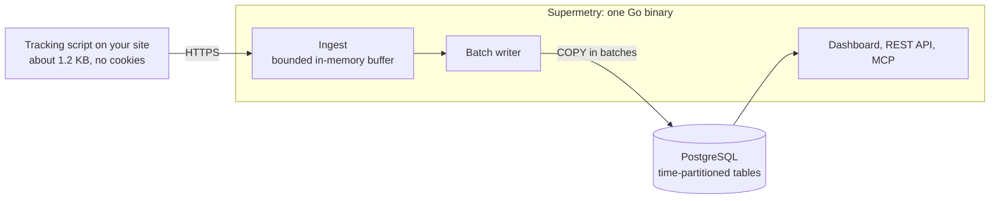

<p align="center">
  <picture>
    <source media="(prefers-color-scheme: dark)" srcset="brand/aurora/svg/supermetry-logo-on-dark.svg">
    
  </picture>
</p>

<h1 align="center">Supermetry: open-source, self-hosted web and product analytics</h1>

<p align="center">
  Cookie-free visitor stats, funnels, revenue, heatmaps and session replay, on your own server.<br>
  One Go binary and PostgreSQL. Nothing else to run.
</p>

<p align="center">
  <a href="LICENSE"></a>
  
  
</p>

<p align="center">
  <a href="#quick-start"><b>Quick start</b></a> ·
  <a href="#who-it-is-for">Who it is for</a> ·
  <a href="#how-it-works">How it works</a> ·
  <a href="#track-events-and-revenue">Events and revenue</a> ·
  <a href="#faq">FAQ</a>
</p>

<p align="center">
  <picture>
    <source media="(prefers-color-scheme: dark)" srcset="docs/assets/dashboard-dark.png">
    
  </picture>
</p>

> **Status: pre-release.** Expect breaking changes until `v0.1.0`.

## Why we built it

Website analytics usually means picking one of three compromises:

1. **Google Analytics**: free and powerful, but your visitors' data goes to Google and it sets cookies.
2. **A lightweight privacy tool**: simple and cookie-free, but the self-hosted edition often stops at pageviews and sources.
3. **A full product analytics stack**: funnels, retention and session replay, but you operate ClickHouse, Kafka or Redis to get them.

Supermetry is the fourth option: an open-source, self-hosted analytics platform that covers web and product analytics, keeps every number in your own PostgreSQL database, and runs as a single Go binary.

## Who it is for

- **Websites, blogs and documentation sites** that want accurate visitor numbers with as little consent as possible: no cookies, no raw IPs and no cross-site tracking.
- **SaaS and product teams** that need goals, funnels, retention cohorts, user journeys, revenue and session replay without sending user data to a third party.
- **Agencies and hosting providers** that look after many sites: organizations, projects, roles, shareable links, alerts and scheduled email reports.
- **Self-hosters** who want something that fits on a small server next to the PostgreSQL they already run.

## Quick start

You need PostgreSQL (CI runs 18). Redis is not needed. On Linux and macOS:

```sh
curl -fsSL https://github.com/velixio/supermetry/releases/latest/download/install.sh | sh
```

<details>
<summary>Windows, Docker Compose and dry run</summary>

Windows PowerShell:

```powershell
irm https://github.com/velixio/supermetry/releases/latest/download/install.ps1 | iex
```

Docker Compose, with a bundled PostgreSQL:

```sh
git clone https://github.com/velixio/supermetry.git && cd supermetry
cp .env.example .env    # set SUPERMETRY_SECRET_KEY and POSTGRES_PASSWORD
docker compose -f deploy/docker-compose.yml --profile bundled-db up -d --build
```

To see what the installer would do first, add `-s -- --dry-run` after `sh`.

</details>

Open `<your URL>/app`, create your admin account, and add the snippet from **Settings, Installation** to your site:

```html
<script defer src="https://analytics.example.com/js/YOUR_SITE_ID.js"></script>
```

Not ready to touch your site yet? Choose **Explore with demo data** after signing up. You get a project with 90 days of realistic, live sample traffic that deletes itself after 24 hours.

More: [deployment guide](deploy/README.md) (unattended installs, upgrades, backups, reverse proxies) and [every setting](docs/guide/configuration.md).

## How it works



- **Ingest never waits on the database.** Events go into a bounded in-memory buffer and are written to PostgreSQL in batches. When the buffer is full, the server answers 503 with `Retry-After` and counts the drop, instead of growing without limit.
- **Visitors without cookies.** A visitor ID is derived from the IP address and user agent with a random salt that changes daily and is deleted after about 48 hours. The IP address itself is never stored.
- **Finished days are compacted** into rollups in each site's own time zone, so long date ranges do not rescan raw events.
- **Retention drops whole time partitions** instead of running bulk deletes.

## Track events and revenue

Pageviews are automatic. Mark up a button to count clicks as an event, with properties:

```html
<button data-supermetry-event="Signup" data-supermetry-prop-plan="pro">Start free trial</button>
```

Or call the tracker from JavaScript, optionally with revenue:

```js
supermetry.track("Purchase", { plan: "pro" }, { revenue: { amount: 29, currency: "USD" } });
```

In projects with profiles on, `supermetry.identify("user-123", { plan: "pro" })` links events to a user profile. A typed TypeScript wrapper lives in [sdk/js](sdk/js/README.md).

## Features

| Area | What you get |
|---|---|
| Web analytics | Visitors, visits, pageviews, bounce rate, visit duration, time on page, realtime, comparison with the previous period or year |
| Breakdowns | Page, entry and exit page, source, channel, UTM, country, region, city, language, browser, operating system, device; filters on any dimension; saved segments |
| Product analytics | Custom events and properties, goals, funnels, revenue, retention cohorts, user journeys, annotations |
| Experience | Web Vitals (LCP, CLS, INP, FCP, TTFB), click and scroll heatmaps, session replay, each opt-in per project |
| Explore | Sessions explorer, events explorer, user profiles with `identify` |
| Teams | Organizations, projects, roles, two-factor sign-in, shareable links, API keys |
| Alerts and reports | Email, webhook, Slack, Discord and Telegram alerts; scheduled email reports |
| Data in and out | REST API, MCP endpoint, CSV export; imports from Google Analytics 4, Plausible, Umami, Mixpanel and Amplitude |
| Operations | Backup and restore commands, a protected metrics endpoint, a data health page, country lookups from a bundled [DB-IP](https://db-ip.com) database with optional [MaxMind GeoLite](https://www.maxmind.com) detail |

## Tested, with the method published

- **Load:** in a 4-hour soak test the server ingested 200 events per second, 2.88 million events in all, with no loss, no errors and a worst-case p99 latency of 23 ms, using under 190 MiB of memory. [Method and results](tools/bench/soak/README.md).
- **Accuracy:** Supermetry and Plausible Community Edition received identical traffic from real browsers. Visitors, visits, pageviews, bounce rate, pages, sources, campaigns, devices, browsers, operating systems and custom events all matched, in both products and against hand-computed truth. [Method and results](tools/bench/accuracy/ab/README.md).

## Supermetry vs Plausible, Umami and Google Analytics

| | Supermetry | Plausible CE (self-hosted) | Umami | Google Analytics |
|---|---|---|---|---|
| Self-hosted | Yes | Yes | Yes | No |
| License | Apache-2.0 | AGPL-3.0 | MIT | Proprietary |
| What you run | One Go binary + PostgreSQL | Elixir app + PostgreSQL + ClickHouse | Node.js app + PostgreSQL | Nothing; Google hosts it |
| Cookies | None | None | None | Yes |
| Funnels, journeys and revenue | Yes | No (Plausible Cloud only) | Yes | Yes |
| Session replay and heatmaps | Yes | No | Yes | No |

<sub>Checked against the Plausible Community Edition and Umami 3.4 source code in October 2026. Corrections are welcome in an issue.</sub>

## Privacy

Supermetry never uses cookies or stores raw IP addresses. By default (`identified` mode) it keeps page paths, referrers and campaigns. `SUPERMETRY_TRACKING_MODE=anonymous` is the strictest mode: page paths are replaced by a placeholder unless you list them as public, and referrers, campaigns, event properties, user profiles and the explorers are off. Session replay and heatmaps are separate opt-ins, and the tracker honours Do Not Track and Global Privacy Control. [Tracking and privacy](docs/tracking-privacy.md) lists exactly what each setting records.

## FAQ

**Is Supermetry a free Google Analytics alternative?**
Yes. It is open source under Apache-2.0 and you host it yourself. It measures visitors, pageviews, sources, goals and conversions without cookies, and the data stays in your own PostgreSQL database.

**Is Supermetry GDPR compliant? Do I need a cookie banner?**
That depends on the laws that apply to you and on what else your site runs, so ask your own counsel. Supermetry is designed to need as little consent as possible: no cookies, no raw IPs and no cross-site tracking.

**Can I import my data from Google Analytics, Plausible or Umami?**
Yes. In the project settings, import a Google Analytics 4 report export or data from Plausible, Umami, Mixpanel or Amplitude. You can preview an import before it runs and undo it afterwards, and overlapping days are never counted twice.

**How is it different from Plausible or Umami?**
Self-hosted Plausible needs ClickHouse next to PostgreSQL and leaves out funnels, journeys and revenue goals. Umami runs on Node.js. Supermetry is a single Go binary on PostgreSQL alone, with every feature in the open-source release.

**How big a server do I need?**
A small one. In the 4-hour test above, a single process used under 190 MiB of memory at a sustained 200 events per second.

## Documentation

[Deployment](deploy/README.md) · [Configuration](docs/guide/configuration.md) · [Tracking and privacy](docs/tracking-privacy.md) · [API](docs/api.md) · [API authentication](docs/api-auth.md) · [Authorization](docs/authorization.md) · [Notifications](docs/guide/notifications.md) · [JavaScript SDK](sdk/js/README.md)

## Contributing

Build from source with Go and [Bun](https://bun.sh) using `make build`. `make dev` runs a development server and starts PostgreSQL in Docker for you; `make test` runs the Go tests. [CONTRIBUTING.md](CONTRIBUTING.md) has the details, and [SECURITY.md](SECURITY.md) explains how to report a vulnerability privately.

## License

[Apache-2.0](LICENSE). Third-party notices are in [NOTICE](NOTICE) and [THIRD_PARTY.md](THIRD_PARTY.md).
